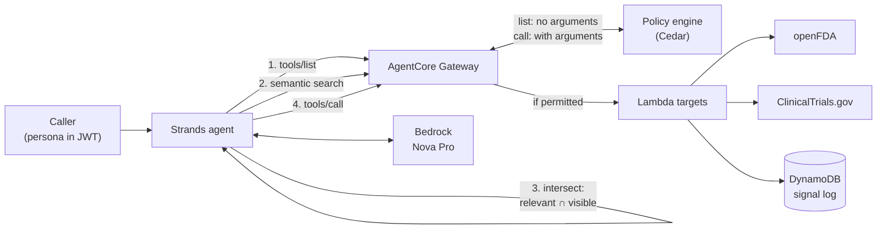

# Your agent shouldn't know about tools it can't use

A Strands agent that discovers its tools per request through Amazon Bedrock AgentCore Gateway, where Cedar policies decide which tools each caller can see and call.

The tools are real: openFDA (adverse events, recalls, drug labels), ClinicalTrials.gov, and a DynamoDB-backed safety signal log that writes permanent records.



`tools/list` is policy-filtered. Semantic search is not, so the agent only sends the model tools that appear in both. The full architecture is in [`docs/architecture.drawio`](docs/architecture.drawio) ([PNG](docs/architecture.png)), and the measured results are in [`RESULTS.md`](RESULTS.md).

## Personas and what they get

| Persona | Can see and call | Notes |
|---|---|---|
| `clinical_ops` | `search_trials`, `get_drug_label` | No adverse event mining, recalls or signal log |
| `safety_analyst` | All read tools, `list_safety_signals`, `log_safety_signal` | **Cannot** log a `critical` signal: it's listed, but denied at call time |
| `safety_lead` | Everything | Only persona allowed to log `critical` signals |

The `critical` rule is the interesting one. Tool listing is a meta action evaluated without input arguments, so a tool is listed if *any* call to it could be permitted. Visibility and authorization are two separate layers, and this repo demonstrates both.

## What's verified and what you're testing

- **Documented:** `tools/list` is filtered by policy. Calls are evaluated with the full request, including arguments. Default deny, and `forbid` wins over `permit`.
- **Not documented either way:** whether `x_amz_bedrock_agentcore_search` results are policy-filtered, and whether the search tool itself needs a `permit`. `demo/discovery_matrix.py` answers both. The agent intersects search results with `tools/list` regardless, so it's safe whatever the answer.
- **What we measured (us-east-1, October 2026, policy in `ENFORCE`; details in [`RESULTS.md`](RESULTS.md)):** search results are *not* policy-filtered. For `clinical_ops`, every query returned all six tools, including the four `tools/list` hid. The search tool needs no `permit`: it is callable by every persona, though it drops out of `tools/list` under `ENFORCE`. Policy denials arrive as a JSON-RPC error (code -32002). Run the matrix yourself; this is undocumented behaviour and may change.

## Layout

```
tools/            Lambda targets (stdlib only) + inline tool schemas
policies/         Cedar policies ({{GATEWAY_ARN}} filled in at setup)
cognito_pretoken/ Adds a string `persona` claim, which Cedar reads via principal.getTag("persona")
infra/            CDK: Lambdas, DynamoDB, Cognito, Gateway execution role
scripts/          setup_gateway.py (engine → gateway → targets → policies → users), teardown.py
demo/             discovery_matrix.py (step one), token_compare.py (the hook number)
agent/            Strands agent with per-request discovery
tests/            Offline tests (no AWS or network needed)
docs/             architecture.drawio (editable) and architecture.png
RESULTS.md        What a live run showed, written up for the post
results/          Raw output of the last matrix and token runs
```

## Run it

Prerequisites: Python 3.13+, Node 22+ (for CDK), AWS credentials in a [Policy-supported region](https://docs.aws.amazon.com/bedrock-agentcore/latest/devguide/policy.html), and Bedrock access to Amazon Nova Pro (the default `MODEL_ID`).

```bash
uv sync                       # or: pip install -e . && pip install -r infra/requirements.txt
uv run pytest                 # offline tests

cd infra
uv run npx aws-cdk@latest bootstrap             # once per account/region
uv run npx aws-cdk@latest deploy --outputs-file ../cdk-outputs.json
cd ..

uv run scripts/setup_gateway.py           # policy engine attached in LOG_ONLY
uv run demo/discovery_matrix.py --no-writes   # smoke test only: nothing is enforced yet
# Check the Gateway's policy decision logs in CloudWatch, then:
uv run scripts/setup_gateway.py --enforce
uv run demo/discovery_matrix.py           # the real answer; writes results/discovery_matrix.md
uv run demo/token_compare.py              # writes results/token_compare.md

uv run agent/agent.py --persona clinical_ops "Any recruiting phase 3 semaglutide trials in obesity?"
uv run agent/agent.py --persona clinical_ops "What are the top serious adverse events for semaglutide?"
uv run agent/agent.py --persona safety_analyst "Log a critical signal for drug X based on faers:drug x"
```

The second agent run is the failure case: search ranks `search_adverse_events` first, but the clinical ops persona can't see it, so the agent drops it and the model only gets `get_drug_label` and `search_trials`. The agent replies that it doesn't have access to adverse event report data. The third run shows a listed tool denied at call time (Strands logs the `MCPError` traceback before the agent reports the denial).

`MODEL_ID` defaults to `us.amazon.nova-pro-v1:0`. Set it to any Bedrock model or inference profile with tool use that you have access to. Anthropic models need the use case form submitted in the Bedrock console first.

Tear down:

```bash
uv run scripts/teardown.py && (cd infra && uv run npx aws-cdk@latest destroy)
```

Teardown waits for each delete to finish. If something can't be deleted it keeps `.demo-state.json` and exits non-zero, so re-run it before `cdk destroy`.

## Things worth knowing

- **Semantic search can only be enabled at gateway creation.** You can't add it later.
- **Policy order matters.** Create the engine first (the gateway needs its ARN), create targets before policies (policies are validated against a schema generated from the targets), and start in `LOG_ONLY`.
- **Permits before forbids.** `CreatePolicy` rejects a `forbid` as "overly restrictive" if no `permit` exists yet for the same principal type and action. Scope the `forbid` to `AgentCore::OAuthUser` (an unscoped `principal` also covers `IamEntity`, which has no permit) and create it last.
- **The Gateway throttles bursts** (HTTP 429), semantic search especially. The raw client retries with backoff.
- **Gateway execution role** needs `AuthorizeAction`, `PartiallyAuthorizeActions` and `GetPolicyEngine`, or every call is denied. The CDK stack grants them on `policy-engine/*` and `gateway/*` in-account. Scope them to the IDs in `.demo-state.json` once setup has run.
- **The role running setup** needs `bedrock-agentcore:InvokeGateway`, because `CreatePolicy` validates actions by calling the gateway.
- **Hiding a tool isn't enough to get "I don't have access".** With only a generic instruction, the model answered the adverse-event question from the drug label instead. The agent now has a stricter system prompt, and when the top-ranked search result is a tool the caller can't see, it tells the model the best match is unavailable (without naming it) and to decline. That second, deterministic signal is what made the decline reliable. It depends on search being unfiltered; if that changes, only the prompt remains.
- **Why a `persona` claim?** Cedar reads JWT claims as string tags. Cognito's `cognito:groups` is an array, so the pre-token trigger flattens it into one string. Access-token customization needs the Cognito Essentials plan.
- **Drug name lookups** try the generic name, then the brand name. A name also matches combination products (`metformin` matches sitagliptin/metformin), so `get_drug_label` prefers the single-ingredient label and returns `active_ingredients` and `combination_product` so the agent can say which product it read.
- **If the search tool is denied** under `ENFORCE`, the matrix says so and its verdict is "inconclusive", and the agent falls back to everything `tools/list` returned (still policy-filtered, just no token saving).
- **`MCP_PROTOCOL_VERSION`** is optional. The raw JSON-RPC client omits the `MCP-Protocol-Version` header by default; set it to a version your gateway supports if raw calls are rejected.
- **Audit trail:** the signal log stores the AgentCore request and MCP message IDs, so each record joins to the Gateway's policy decision log, which holds the caller identity and the allow/deny result. The Lambda doesn't see the user's JWT. If the record itself must carry the user, add a Gateway REQUEST interceptor to pass it through.
- **USER_PASSWORD_AUTH and DEBUG exception level** keep the demo scriptable and readable. Use SRP or hosted UI, and drop `exceptionLevel`, for anything real.

## References

- [Use an AgentCore Gateway with Policy](https://docs.aws.amazon.com/bedrock-agentcore/latest/devguide/use-gateway-with-policy.html)
- [Gateway semantic search](https://docs.aws.amazon.com/bedrock-agentcore/latest/devguide/gateway-using-mcp-semantic-search.html)
- [Policy IAM permissions](https://docs.aws.amazon.com/bedrock-agentcore/latest/devguide/policy-permissions.html)
- [openFDA](https://open.fda.gov/apis/) · [ClinicalTrials.gov API v2](https://clinicaltrials.gov/data-api/api)
