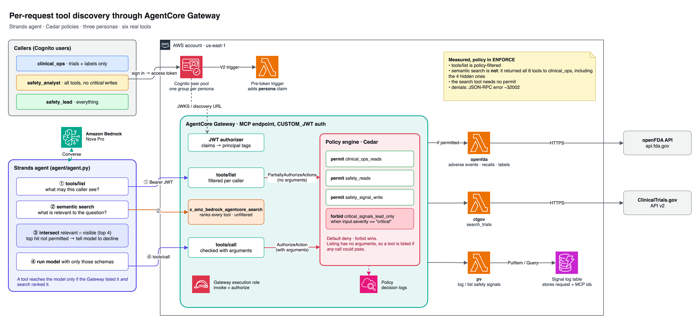

# Results: does tool discovery respect policy?

Measured on a live Amazon Bedrock AgentCore Gateway in `us-east-1` on 11 October 2026, with the policy engine in `ENFORCE`. Six tools across three Lambda targets, three personas, four Cedar policies. The agent and token measurements used Amazon Nova Pro (`us.amazon.nova-pro-v1:0`).

Everything here is reproducible with `demo/discovery_matrix.py`, `demo/token_compare.py` and `agent/agent.py`. Raw output is in [`results/`](results/). Some of this behaviour is undocumented and may change, so re-run it before relying on it.



## The short version

1. **`tools/list` is policy-filtered.** Each persona sees only the tools a policy could let it call.
2. **Semantic search is not policy-filtered.** It returned every tool to every persona, including tools the same caller's `tools/list` hid.
3. **The search tool needs no `permit`.** Any authenticated caller can use it. Under `ENFORCE` it disappears from `tools/list` but stays callable.
4. **Listed does not mean authorized.** A tool with an argument-dependent `forbid` is listed, then denied at call time.
5. **So the agent has to intersect.** Search tells you what is relevant; `tools/list` tells you what is allowed. Only tools in both should reach the model.

## 1. `tools/list` is filtered per caller

| Persona | Tools returned by `tools/list` |
|---|---|
| `clinical_ops` | `get_drug_label`, `search_trials` |
| `safety_analyst` | all six |
| `safety_lead` | all six |

In `LOG_ONLY` every persona saw all six tools plus the search tool, so a `LOG_ONLY` run tells you nothing about filtering.

## 2. Semantic search ignores policy

`clinical_ops` may see two tools. For each of four queries, `x_amz_bedrock_agentcore_search` returned all six, ranked by relevance:

| Query (as `clinical_ops`) | Top result | Returned but hidden by `tools/list` |
|---|---|---|
| how many serious adverse event reports are there for semaglutide | `search_adverse_events` | `search_adverse_events`, `list_safety_signals`, `log_safety_signal`, `search_recalls` |
| find recruiting phase 3 trials for type 2 diabetes | `search_trials` | `search_recalls`, `search_adverse_events`, `log_safety_signal`, `list_safety_signals` |
| has metformin been recalled | `search_recalls` | `search_recalls`, `search_adverse_events`, `log_safety_signal`, `list_safety_signals` |
| record a new safety signal for review | `log_safety_signal` | `log_safety_signal`, `list_safety_signals`, `search_adverse_events`, `search_recalls` |

That is 16 hidden tools surfaced across four queries. The search results include each tool's name, description and input schema, so a caller learns what exists even though it cannot call it. The ranking was identical for all three personas.

With only six tools, search returned the whole catalog every time. It ranks; it does not cut. The agent applies its own top-k (`MAX_TOOLS=4`).

## 3. Call-time decisions

| Persona | Call | Result |
|---|---|---|
| `clinical_ops` | `search_adverse_events` | **Denied**: no policy applies (default deny) |
| `clinical_ops` | `search_trials` | Allowed |
| `safety_analyst` | `log_safety_signal`, severity `critical` | **Denied** by `critical_signals_lead_only` |
| `safety_analyst` | `log_safety_signal`, severity `low` | Allowed |
| `safety_lead` | `log_safety_signal`, severity `critical` | Allowed |

The analyst's `tools/list` includes `log_safety_signal`. Listing is evaluated without arguments, so a tool is listed if any call to it could be permitted. The `forbid` on `severity == "critical"` only bites at call time.

Denials came back as a JSON-RPC error, and the message names the deciding policy:

```json
{"jsonrpc": "2.0", "id": 1, "error": {"code": -32002, "message":
 "Tool Execution Denied: Tool call not allowed due to policy enforcement [Policy evaluation denied due to critical_signals_lead_only-bk9zn__6ww]"}}
```

A default-deny reads `[No policy applies to the request (denied by default).]`.

## 4. What the agent does with this

Per question the agent calls `tools/list`, calls search, and sends the model only tools that appear in both (top four by search rank).

| Persona | Question | Tools sent to the model | Outcome |
|---|---|---|---|
| `clinical_ops` | Any recruiting phase 3 semaglutide trials in obesity? | `search_trials`, `get_drug_label` | Answered from ClinicalTrials.gov |
| `clinical_ops` | What are the top serious adverse events for semaglutide? | `get_drug_label`, `search_trials` | "I don't have access to the data needed… adverse event report data" |
| `clinical_ops` | Has metformin been recalled recently? | `get_drug_label`, `search_trials` | "I don't have access to recall data" |
| `safety_analyst` | What are the top serious adverse events for semaglutide? | `search_adverse_events` + 3 others | Answered from FAERS: nausea 4,911 reports, vomiting 4,285, … |
| `safety_analyst` | Log a critical signal for drug X | `log_safety_signal` + 3 others | Tool called, Gateway denied it, agent reported "not permitted" |
| `safety_lead` | Log a critical signal for drug X | `log_safety_signal` + 3 others | Signal written to DynamoDB |

**Getting a clean "I don't have access" took two things.** With a generic "say so if you lack a tool" prompt, the `clinical_ops` agent answered the adverse-event question from the drug label's warnings instead: a plausible answer from the wrong source. A stricter prompt fixed it two times out of three. What made it reliable (four out of four) was a deterministic signal: when the top-ranked search result is a tool the caller cannot see, the agent tells the model that the best-matching capability is unavailable, without naming it, and to decline. Hiding a tool is not enough on its own; the model will reach for the nearest thing it does have.

## 5. Token cost

Input tokens per request, measured with Bedrock Converse on Nova Pro:

| Query | Tools sent | Input tokens | Full catalog | Change | Search latency |
|---|---|---|---|---|---|
| serious adverse event reports for semaglutide | 4 of 6 | 1,005 | 1,410 | −29% | 470 ms |
| recruiting phase 3 trials for type 2 diabetes | 4 of 6 | 1,101 | 1,408 | −22% | 516 ms |
| has metformin been recalled | 4 of 6 | 1,041 | 1,401 | −26% | 452 ms |
| record a new safety signal | 4 of 6 | 994 | 1,404 | −29% | 438 ms |

Each tool schema cost about **174 tokens**, plus a fixed **353 tokens** whenever any tools are sent. Search added roughly half a second per question.

With six tools the saving is modest. The per-tool cost is what scales. This projection is arithmetic on the measured figures, not a measurement, and assumes schemas the size of this repo's:

| Catalog size | All tools in context | Search-scoped (4 tools) |
|---|---|---|
| 50 | 9,053 | 1,049 |
| 200 | 35,153 | 1,049 |
| 1,000 | 174,353 | 1,049 |

## 6. Things that only showed up on a real deployment

- **Permits before forbids.** `CreatePolicy` rejected the `forbid` as "overly restrictive" until a `permit` existed for the same principal type and action. An unscoped `principal` also covers `AgentCore::IamEntity`, which has no permit, so the `forbid` needs `principal is AgentCore::OAuthUser`.
- **The Gateway throttles bursts.** A tight loop of search calls returned HTTP 429. Retry with backoff.
- **Denials are JSON-RPC errors (−32002)**, not `isError` results as the docs example shows. Handle both.
- **Anthropic models on Bedrock need a use case form** submitted for the account before the first call.

## Caveats

- One region, one day, six tools, four queries. Enough to show the behaviour, not to characterize it.
- The agent outcomes are single runs on Nova Pro, apart from the decline case (four runs). Other models may behave differently.
- The FAERS counts are spontaneous reports. They do not establish causation or incidence.
